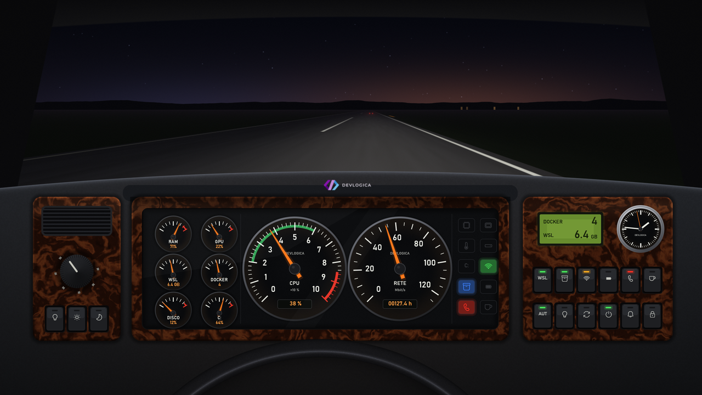
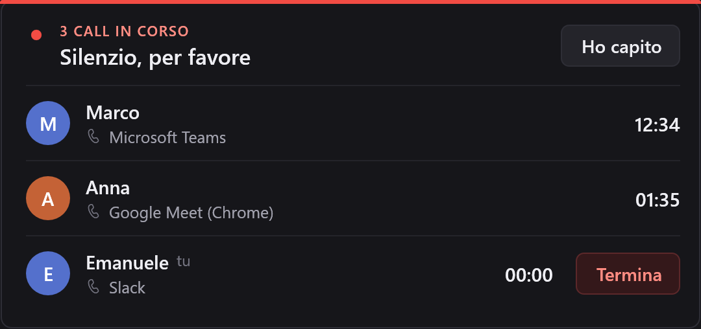
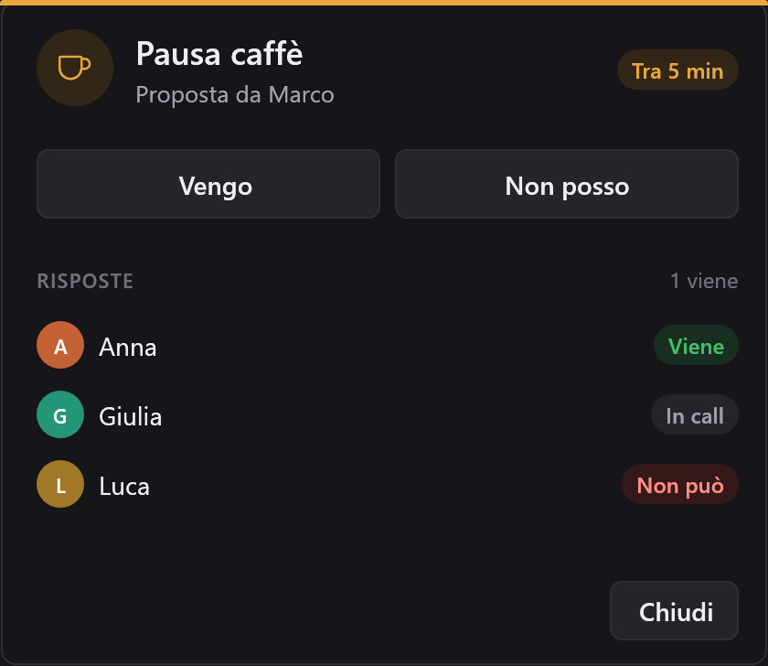
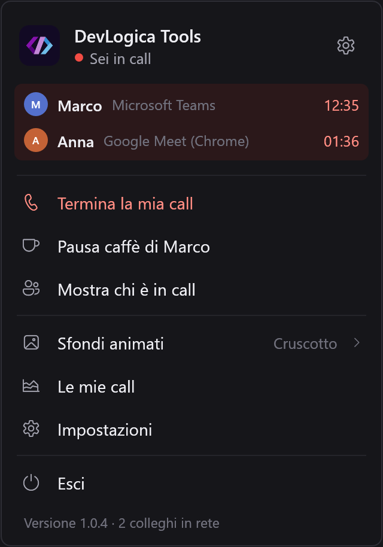
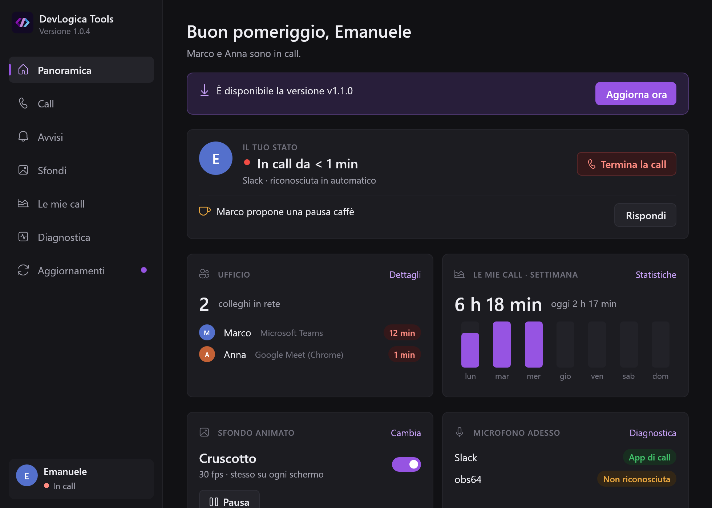

# DevLogica Tools

L'app dell'ufficio DevLogica, per **Windows** e **macOS**:

- **Avvisi di call**: quando un collega entra in call, sugli altri PC compare un avviso. Il riconoscimento è automatico per Teams, Slack, Zoom, Meet e le altre app.
- **Pausa caffè**: qualcuno la propone, gli altri rispondono *Vengo!* o *Non posso*, e tutti vedono le risposte in tempo reale.
- **Sfondi**: otto sfondi animati e tre fissi disegnati dalla scheda grafica, con supporto multimonitor. Tra questi il **Cruscotto**: la plancia di un camion anni '90 di notte, con gli strumenti che mostrano CPU, RAM, GPU, WSL, Docker, disco e rete in tempo reale.

È leggerissima: un unico eseguibile di pochi MB, senza server e senza account. I PC si parlano direttamente sulla rete dell'ufficio.



| Avviso di call | Pausa caffè | Menu dell'icona (Windows) |
|---|---|---|
|  |  |  |



---

## Installazione (per tutti)

Scarica l'ultima versione dalla pagina **Releases** del repository.
Dalla 1.0.4 in poi gli aggiornamenti si installano dall'app stessa (vedi *Aggiornamenti*); chi ha una versione precedente installa la 1.0.4 a mano un'ultima volta.

### Windows
1. Scarica `DevLogica-Tools-Windows.exe` e mettilo in una cartella stabile, per esempio `Documenti\DevLogica Tools`. Non serve installazione.
2. Al primo avvio SmartScreen mostra "Windows ha protetto il PC": clicca **Ulteriori informazioni**, poi **Esegui comunque**.
3. Se compare l'avviso del firewall, consenti l'accesso alle **reti private**. Senza questo permesso gli avvisi dei colleghi non arrivano.
4. Dal menu dell'icona attiva **Avvia all'accesso**.

### macOS
1. Scarica `DevLogica-Tools-macOS.zip`, estrailo e sposta **DevLogica Tools** in **Applicazioni**. Funziona sia su Apple Silicon sia su Intel.
2. Al primo avvio macOS blocca l'app: vai in **Impostazioni di Sistema → Privacy e sicurezza** e clicca **Apri comunque**.
   In alternativa, da Terminale:
   ```bash
   xattr -dr com.apple.quarantine "/Applications/DevLogica Tools.app"
   ```
3. Quando macOS chiede di **trovare dispositivi sulla rete locale**, rispondi **Consenti**.
4. Dal menu dell'icona attiva **Avvia all'accesso**.

Al primo avvio si apre la finestra **Impostazioni**: inserisci il tuo nome, cioè quello che vedranno i colleghi.

---

## Come si usa

L'app vive nell'icona della barra di sistema su Windows (vicino all'orologio) o della barra dei menu su macOS.
Su Windows un clic sull'icona apre un menu a comparsa con lo stato dell'ufficio (chi è in call e da quanto), le azioni rapide e le sottopagine per la pausa caffè e gli sfondi; si chiude cliccando altrove o con Esc. Su macOS resta il menu nativo.

Le **Impostazioni** sono una dashboard: la *Panoramica* mostra il tuo stato, chi è in call, le tue call della settimana, lo sfondo e il microfono; le altre pagine (Call, Avvisi, Sfondi, Le mie call, Diagnostica, Aggiornamenti) raccolgono le opzioni, comprese quelle degli sfondi che prima erano solo nel menu.
L'icona cambia in base allo stato:
- **pallino rosso**: c'è qualcuno in call;
- **pallino ambra**: c'è una pausa caffè in corso.

### Call
- **In automatico**: quando entri in call, i colleghi vengono avvisati da soli. Quando la chiudi, l'avviso sparisce.
- **A mano**: menu → *Sto entrando in call* / *Termina la mia call*.
- **Avviso ai colleghi**: riquadro "CALL IN CORSO — Silenzio!" con nome, app e durata, più un bordo rosso pulsante attorno agli schermi. *Ho capito* lo nasconde fino alla prossima call.
- **Suono**: due note morbide, con il volume regolabile nelle impostazioni.

### Pausa caffè
Dal menu scegli *Pausa caffè* → *Adesso* o *Tra 5, 10 o 15 minuti*. Ai colleghi compare l'invito con i pulsanti per rispondere.
Chi ha proposto la pausa vede le risposte e la chiude con *Fine pausa caffè*. In ogni caso la pausa si chiude da sola dopo 20 minuti.

### Non disturbare durante la call
Mentre sei in call (riconosciuta in automatico o avviata a mano) l'app non ti interrompe:
- niente inviti alla pausa caffè e niente avvisi delle call dei colleghi (né riquadro, né bordo rosso, né suono);
- l'icona nella barra continua a cambiare colore, se vuoi dare un'occhiata;
- chi propone il caffè vede *in call* accanto al tuo nome al posto della risposta.

Quando chiudi la call ti arriva quello che è ancora in corso: l'invito alla pausa caffè, se è ancora aperta, e l'avviso dei colleghi ancora in call. Quello che è finito nel frattempo non compare.

### Sfondi
Si scelgono in **Impostazioni → Sfondi** o dal menu dell'icona → *Sfondi*:
- **animati**: Lame di luce, Barre diagonali, Geometrie, Reticolo, Cruscotto, Costellazione, Flusso, Aurora;
- **fissi**: Quiete, Prisma, Isoipse. Vengono disegnati una volta sola e ridisegnati solo quando serve (cambio di schermo, logo o indicatori), quindi a riposo la scheda grafica non lavora.

Le opzioni:
- attivi o disattivati;
- stesso sfondo su ogni schermo, uno diverso per schermo, oppure uno solo esteso su tutti;
- fluidità e risoluzione (le versioni ridotte consumano meno);
- logo, pausa e sfondi personalizzati (vedi più sotto).

### Cruscotto
Sfondo *Cruscotto* (Impostazioni → Sfondi, o dal menu dell'icona). Gli strumenti si aggiornano ogni secondo e le lancette si muovono con un po' d'inerzia; all'avvio fanno il giro di prova fino a fondo scala.
- **Contagiri**: CPU (×10 %), con la fascia verde e la zona rossa. Nel display sotto, la percentuale.
- **Tachimetro**: traffico di rete in Mbit/s; la strada scorre alla stessa velocità. Nel contachilometri, le ore di accensione del PC.
- **Strumenti piccoli**: RAM, GPU, memoria di WSL, container Docker in esecuzione, attività del disco, spazio usato su C:.
- **Display verde**: container Docker e GB di WSL (*OFF* se non sono avviati).
- **Spie**: CPU, RAM, GPU o disco al limite, C: quasi pieno, rete attiva, Docker in esecuzione, batteria scarica, qualcuno in call, pausa caffè.
- **Orologio** analogico nella console di destra.

Su Windows i dati arrivano dagli stessi contatori di Gestione attività (nessun permesso speciale); Docker si interroga sulla sua named pipe, come fa `docker ps`. Su macOS si vedono CPU, RAM e Docker; GPU, WSL e disco restano a riposo.

### Indicatori sullo sfondo (solo macOS)
Ai lati del Dock, dentro lo sfondo animato, l'app mostra **CPU**, **RAM**, **orologio** e **logo DevLogica**.
Si configurano in **Impostazioni → Indicatori sullo sfondo**:
- attivi o disattivati (anche dal menu → *Sfondi* → *Mostra gli indicatori*);
- lo stile: *Solo testo*, *Pillole come il Dock* oppure *Orologio grande*;
- per ogni elemento: *Nascosto*, *Sinistra* o *Destra* del Dock.

Compaiono solo sullo schermo che ha il Dock e si aggiornano ogni 2 secondi. Con gli sfondi disattivati o in pausa non si vedono.

Per sapere quanto è largo il Dock, l'app chiede il permesso **Accessibilità** (*Impostazioni di Sistema → Privacy e sicurezza → Accessibilità*).
Senza permesso gli indicatori funzionano lo stesso, ma lasciano libera una fascia fissa al centro dello schermo.
Con *Dimensione dei testi* e *Dimensione del logo* (dal 75% al 200%) li ingrandisci o rimpicciolisci; *Ripristina* torna al 100%.

L'app non è firmata con un certificato Apple: **dopo ogni aggiornamento** macOS può chiedere di nuovo il permesso Accessibilità, oppure serve togliere *DevLogica Tools* dall'elenco e aggiungerla di nuovo.

### Le mie call
L'app tiene il conto delle tue call: quando iniziano, quando finiscono e con quale app (*Manuale* se la avvii dal menu senza un'app riconosciuta).
Dal menu → *Le mie call…* (o dal pulsante nelle Impostazioni) si apre una finestra con il totale per giorno, settimana, mese e anno, il grafico, la media per giorno lavorativo e il tempo per app.
- **Solo sul tuo PC**: i dati stanno in `call.json`, nella cartella dell'app (vedi *Log* più sotto), e non vengono mai inviati ai colleghi né scritti nel log.
- **Interruttore**: in **Impostazioni → Le mie call** la casella *Registra le mie call* (attiva di default) ferma o riprende la registrazione. Lo storico già salvato resta e si può ancora guardare.
- **Cancellare lo storico**: *Cancella lo storico…* → scegli *Dal* e *Al* (giorni interi, estremi compresi) o premi *Tutto*, poi *Cancella*. L'app dice quante call e quanto tempo toglie e chiede conferma. Una call a cavallo di un estremo viene tagliata: resta la parte fuori dall'intervallo. La cancellazione è definitiva.
- **Sospensione**: se il PC va in sospensione durante una call, il tempo in cui è rimasto sospeso non conta.

### Aggiornamenti
L'app controlla da sola se c'è una versione nuova, all'avvio e due volte al giorno; dal menu **Cerca aggiornamenti** controlla subito.
Quando c'è una versione nuova compare una notifica di sistema e nel menu la voce **Aggiorna alla vX.Y.Z**: un clic e l'app scarica la versione nuova, si sostituisce e si riavvia.
Prima di sostituirsi l'app controlla che il file scaricato abbia lo stesso SHA-256 che GitHub ha calcolato quando è stato pubblicato. Se non coincide, o se la release non lo indica, l'app resta com'è.
- **Windows**: cliccando la notifica parte direttamente l'aggiornamento.
- **macOS**: la notifica è informativa (l'app non è firmata da Apple, quindi macOS non le consente notifiche cliccabili); si aggiorna dal menu o dalle Impostazioni.

Se qualcosa va storto (rete, cartella non scrivibile) l'app resta com'è, lo dice in una notifica e nel menu compare anche *Apri la pagina della release* per scaricarla a mano.

---

## Il riconoscimento automatico delle call

L'app guarda **quale app sta usando il microfono**. Non ascolta né registra niente, e non serve il permesso del microfono.
- **Windows**: legge la stessa informazione dell'icona del microfono nella barra di sistema, cioè quale programma lo sta usando.
- **macOS**: la chiede a CoreAudio.

**App riconosciute**: Microsoft Teams, Slack (anche gli huddle), Zoom, Webex, Discord, Skype, WhatsApp, Telegram, Signal, FaceTime, GoTo Meeting, RingCentral, 3CX. Sono riconosciuti anche i **browser**, per Google Meet, Teams web, Jitsi, Whereby e simili. Su Windows il titolo della finestra permette di scrivere, per esempio, "Google Meet (Chrome)".

**Tempi**:
- l'avviso parte dopo **4 secondi** di microfono aperto, così note vocali e prove audio non contano;
- la call si chiude dopo **10 secondi** di microfono chiuso, così un cambio di cuffie non la interrompe.

**Impostazioni**:
- *Automatico*, *Chiedi conferma* (compare "Sei entrato in call?") oppure *Disattivato*;
- *Considera call anche le app non riconosciute*;
- la sezione **Microfono in uso adesso** mostra in tempo reale cosa viene rilevato. Con **Ignora** escludi un'app, per esempio un registratore o un software di dettatura.

---

## Compatibilità con Call Alert

DevLogica Tools usa lo stesso protocollo di Call Alert: UDP broadcast sulla porta **47832**, con gli stessi messaggi.
Durante il passaggio, chi ha ancora Call Alert vede le call e le pause caffè di chi usa DevLogica Tools, e viceversa.

Le aggiunte sono ignorate da Call Alert:
- il nome dell'app di call;
- i minuti alla pausa caffè;
- il messaggio `CALL_ALIVE`, che fa sparire da sola la call di un PC spento o uscito dalla rete.

Quando tutti sono passati a DevLogica Tools, Call Alert si può disinstallare.

---

## Risoluzione dei problemi

**Gli avvisi non arrivano agli altri PC**
- Tutti devono essere sulla **stessa rete** (stesso router o switch). Alcune reti Wi-Fi "ospiti" isolano i dispositivi tra loro.
- **Windows**: deve essere consentito l'accesso alle reti private per *DevLogica Tools* (*Sicurezza di Windows → Firewall → Consenti app*).
- **macOS**: deve essere attivo il permesso *Rete locale* (*Impostazioni di Sistema → Privacy e sicurezza → Rete locale*).
- Nelle **Impostazioni** dell'app, alla voce *Colleghi in rete*, compare chi è stato trovato.

**La call non viene riconosciuta, o viene riconosciuta quando non dovrebbe**
Apri le **Impostazioni** durante la call: in *Microfono in uso adesso* vedi cosa rileva l'app. Se un'app di call manca dall'elenco, segnalala con il nome che compare lì e si aggiunge.

**Log**
- **Windows**: `%APPDATA%\DevLogica Tools\log.txt`
- **macOS**: `~/Library/Application Support/DevLogica Tools/log.txt`

Nella stessa cartella ci sono le impostazioni (`config.json`), lo storico delle tue call (`call.json`) e la cartella `sfondi` per gli sfondi personalizzati.
Al primo avvio vengono importate le impostazioni e gli sfondi di DevLogica Wallpaper, se presenti.

---

## Sviluppo

### Requisiti
- **Rust 1.95 o successivo** (https://rustup.rs). L'interfaccia usa egui 0.36.
- **Windows**: *Visual Studio Build Tools* con "Sviluppo di applicazioni desktop con C++".
- **macOS**: Xcode Command Line Tools (`xcode-select --install`).

```bash
cargo run --release      # avvia l'app
cargo test               # test di protocollo, logica e riconoscimento
```

Build locali:
- **Windows**: `.\packaging\windows\build.ps1`
- **macOS**: `./packaging/macos/build-app.sh universal`

### Pubblicare una nuova versione
La pipeline in `.github/workflows/release.yml` parte con un **tag di versione**:

```bash
git tag v1.1.0
git push origin v1.1.0
```

GitHub Actions compila Windows e macOS (app universale), esegue i test e pubblica la release con
`DevLogica-Tools-Windows.exe` e `DevLogica-Tools-macOS.zip`. La versione dell'app viene presa dal tag.

Le app installate controllano le release due volte al giorno. Quando ne trovano una nuova la notificano e la installano con *Aggiorna alla vX.Y.Z*.
**I nomi dei file della release non vanno cambiati** (`DevLogica-Tools-Windows.exe`, `DevLogica-Tools-macOS.zip` con dentro `DevLogica Tools.app`): l'aggiornamento dall'app li cerca per nome.
Il repository da controllare viene inserito automaticamente durante la build su GitHub. Per una build locale si può impostare con la variabile `DEVLOGICA_REPO=utente/repo`.

Dalla scheda *Actions* si può anche lanciare la pipeline a mano (*Run workflow*). In quel caso fa solo la build: i file restano tra gli artefatti dell'esecuzione, senza creare una release.

### Strumenti utili
```bash
devlogica-tools --snapshot lame 3840 2160 20 lame.png     # immagine statica di uno sfondo (anche un file .wgsl)
devlogica-tools --ui call anteprima.png                   # anteprima di una finestra (call, caffe, conferma, menu, impostazioni)
devlogica-tools --ui impostazioni:sfondi anteprima.png    # una pagina delle impostazioni (call, avvisi, sfondi, mie, diagnostica, info)
devlogica-tools --statistiche                             # letture del cruscotto su questo PC, per qualche secondo
devlogica-tools --bench [sfondo | file.wgsl] [larg alt]   # ms per fotogramma (senza sfondo: tutti)
devlogica-tools --notifica-prova                          # mostra una notifica di prova (su macOS lanciala dall'app .app)
DEVLOGICA_FAKE_VERSION=1.0.0 devlogica-tools              # finge una versione vecchia per provare l'aggiornamento
```

### Struttura
```
src/main.rs          avvio, istanza unica, opzioni da riga di comando
src/app.rs           coordinatore: rete, call, caffè, finestre, menu, ritmi
src/office.rs        stato dell'ufficio: call e pausa caffè (con test)
src/net.rs           protocollo UDP compatibile con Call Alert (con test)
src/detect.rs        riconoscimento delle call dal microfono (con test)
src/theme.rs         colori, caratteri di sistema (Segoe UI, icone Fluent) e controlli su misura
src/ui.rs            finestre egui: avviso call, caffè, conferma, bordo rosso
src/settingsui.rs    Impostazioni: barra laterale, panoramica e pagine
src/traymenu.rs      menu a comparsa dell'icona (Windows)
src/dash.rs          sfondo Cruscotto: campionatore, disposizione, lancette, spie (con test)
src/callstats.rs     statistiche delle mie call: periodi, totali, grafico, formati (con test)
src/callstore.rs     archivio delle mie call in call.json, salvataggio atomico (con test)
src/statsui.rs       finestra "Le mie call" (egui)
src/tray.rs          menu e icona della barra di sistema
src/wallpaper.rs     sfondi per schermo, modalità multimonitor, ridisegno degli sfondi fissi
src/render.rs        GPU (wgpu): shader degli sfondi e logo
src/indicators.rs    indicatori sullo sfondo: ordine, spazio accanto al Dock, formati (con test)
src/overlay.rs       disegno degli indicatori sopra lo sfondo (egui)
src/sysstats.rs      statistiche CPU e RAM (con test)
src/sound.rs         suoni generati al volo
src/update.rs        controllo aggiornamenti dalle release di GitHub e stati del menu (con test)
src/install.rs       scaricamento, verifica e sostituzione dell'app (con test)
src/notify.rs        notifiche di sistema
src/platform/        Windows (desktop, microfono, avvio, letture del cruscotto) e macOS (idem)
shaders/             sfondi in WGSL
esempi/onde.wgsl     esempio di sfondo personalizzato
```

### Sfondi personalizzati
Menu → *Sfondi* → *Apri cartella sfondi personalizzati*, copia lì un file `.wgsl` e poi scegli *Ricarica sfondi*.
Uno sfondo definisce due funzioni:
- `fn scene(p: vec2f) -> vec3f`, che dà il colore del pixel;
- `fn logo_layout() -> vec3f`, che dà posizione e larghezza del logo.

Per uno sfondo fisso aggiungi `// tipo: fisso` nelle prime righe di commento: l'app lo disegna una volta sola, quindi non deve usare `u.time`.
Uno sfondo animato viene ridisegnato a ogni fotogramma: con `--bench` puoi controllare quanto costa (meglio stare sotto i 3 ms).

Puoi partire da `esempi/onde.wgsl`.
